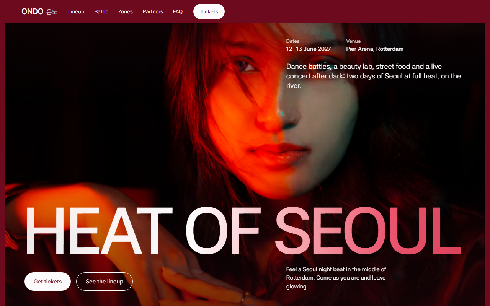
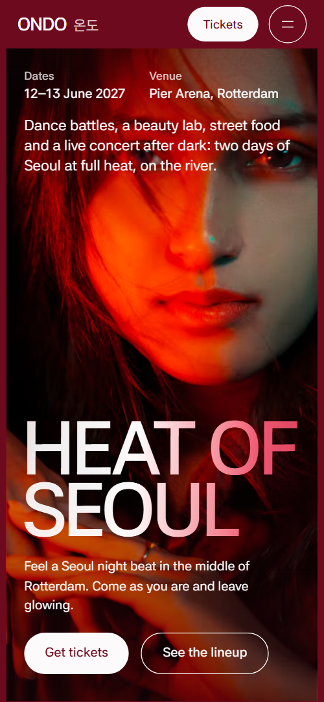
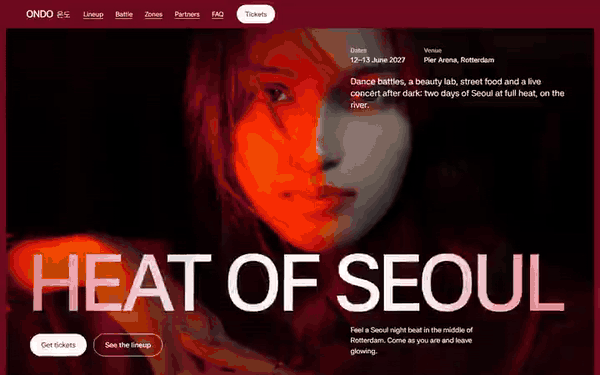

# Free HTML event website template with GSAP scroll animations

Event website template: a one-page site for a festival, concert or fan event, with a day schedule, a lineup, venue zones, a food board and three ticket passes. The look is crimson, red, near-black and white slides under huge capitals. It is one free HTML file of 152 KB with an AGENTS.md, so an AI agent such as Claude Code or Cursor can adapt it to your own event.

[](LICENSE)  

**[Live demo](https://8bsite.github.io/event-website-template/)** · **[Use this template](https://github.com/new?template_name=event-website-template&template_owner=8bsite)** · **[Download ZIP](https://github.com/8bsite/event-website-template/archive/refs/heads/main.zip)** · **[Template page on 8b.com](https://8b.com/templates/ondo/)**

<a href="https://8bsite.github.io/event-website-template/"></a> <a href="https://8bsite.github.io/event-website-template/"></a>

<p align="center"><a href="https://8bsite.github.io/event-website-template/"></a><br><sub>Scroll animation</sub></p>

## Use it with Claude Code, Cursor or Codex

Download the four files into your project folder (`curl.exe` in Windows PowerShell):

```bash
curl -LO https://raw.githubusercontent.com/8bsite/event-website-template/main/index.html
curl -LO https://raw.githubusercontent.com/8bsite/event-website-template/main/AGENTS.md
curl -LO https://raw.githubusercontent.com/8bsite/event-website-template/main/LICENSE
curl -LO https://raw.githubusercontent.com/8bsite/event-website-template/main/CREDITS.md
```

Then fill in the angle brackets and give your agent this prompt:

```text
Read AGENTS.md, then edit index.html. Turn this into the site for <my event: name, dates, venue and address, the lineup with days, stages and set times, the daily schedule, the areas, ticket types with prices and the ticket shop link, organiser email and phone, sponsor audience figures if any>. Replace first the event name, dates, venue, act names and pass prices. Keep the section ids, the classes AGENTS.md lists, each --len number equal to its text length, and each schedule ring paired with its hole in the opening mask. Ask me for missing facts and never invent prices, times, capacities, addresses, visitor numbers, sponsors or contacts.
```

A vibe coding agent such as Claude Code, Cursor or Codex should replace the event name, dates, venue, act names with their days, stages and times, and the three pass prices first. It should then ask you for what only the organiser knows, such as the ticket shop address, refund rules, capacity, visitor figures and sponsor details, and never invent them. Each display line has a --len number that must equal its character count, spaces included. The schedule is drawn for nine rings, three rows of three on narrow screens, and each ring has a matching hole in the opening mask, so add or remove them in pairs. Act rows can be added or removed.

No agent? Click **[Use this template](https://github.com/new?template_name=event-website-template&template_owner=8bsite)**, edit `index.html` on GitHub and turn on **Settings > Pages**.

## Sections and motion

- **Navigation**: top bar: wordmark, section links, Tickets button; phone menu overlay with dates and venue.
- **Heat of Seoul**: two-screen opening: a full-bleed photo under a huge title, then nine round windows onto it with the day's schedule. Smooth scrolling throughout. Scrolling, the photo zooms and the title splits apart, then a crimson veil closes into nine round schedule windows.
- **On the bill**: the bill: five act names set full width, each with a round portrait and day, stage and time. Several headings warm from dim to white as they arrive. Each portrait swells mid-screen as its name glides sideways and heats up.
- **Crew battle**: split screen: two sides with a moving VS line (demo: a dance crew battle). Pinned, the VS line sweeps to one side, then the other, then back to centre as each crew's name grows and the rounds light up.
- **One hall, four heats**: venue plan with four round zone windows and a description of each. The round venue plan holds still and zooms onto each zone as its text scrolls past, the others dimming.
- **Idol looks**: sideways track of three items, each a tall photo with times, name, text and three steps (demo: make-up looks). The white slide pins and its track moves sideways; each look's photo opens from a small circle.
- **Food street**: menu board with prices, names in two languages, two photos. On arrival, the round stall photo spins in and the menu rows fade up as their rules draw across.
- **Who fills the hall**: for sponsors: audience in four columns with bars sized by share, a portrait and a deck button. Tied to scroll, the portrait rises into place and the four audience bars grow up one after another.
- **The photo wall**: photo wall: eight photos, rectangles and circles, red-tinted. Each red-tinted photo flashes its true colours as it crosses mid-screen, the columns slightly out of step.
- **Passes**: three ticket tiers as wristband passes with prices and buttons. On wide screens the three passes start bunched and fanned like a hand of cards, then spread into a row.
- **Before you come**: questions and answers (native &lt;details&gt;) with a contact e-mail.
- **See you on the river**: contact block framed by rings: e-mail, venue address, travel, phone, press e-mail. Tied to scroll, four rings widen one after another behind the contact details while the heading heats up.
- **Footer**: width-filling ONDO 온도 wordmark, links, copyright and the Design: 8B credit.

## Design

 deep crimson page and slides  
 red slides and photo tint  
 white text, buttons, light slides  
 near-black slides  
 pink hot edge, hover sweeps  
 orange-red in gradients

**Asta Sans**: the only family: huge tight uppercase headings, text and Hangul (Google Fonts). Sections are slides inset by a thin crimson margin, switching between near-black, crimson, red and white. Section headings are huge, tight capitals, most of them filled with a gradient; many photos are greyscale or tinted red. Circles recur: schedule rings, round portraits, a round venue plan, round crops and rings around the contact.

## Questions

**Can visitors buy passes or register on the page?**  
No. There is no form and no checkout. The three Choose buttons scroll to the contact block and Tickets and Get tickets scroll to the passes, so point them at your ticket shop. Enter your crew and Request the partner deck open email drafts to demo addresses: swap in a sign-up link or a real mailbox. A form you add later needs a service such as Formspree or Netlify Forms.

**Is there a live event website example I can look at first?**  
Yes. The live demo is a complete example: a two-day K-culture festival in Rotterdam. Every date, act, price and contact in it is invented. The same file sits in the GitHub repository, where Use this template makes you a copy.

**What in the demo is invented and must be replaced?**  
All of it. Dates, venue, address, tram lines, act names, set times, prices, entry and refund rules, visitor figures, email addresses and the phone number are made up, and AGENTS.md lists them. The photo wall is static and nothing collects tagged photos, so reword that paragraph and its caption, or connect a feed.

## Is it the right base?

The right base is an event that runs a day or a weekend with several things happening at once: a lineup, a timetable, a few venue areas and ticket tiers. For a single show, an event page template with a date, a venue and one button is simpler. A permanent venue that sells timed passes and takes birthday or group bookings, such as a [trampoline park](https://8b.com/templates/hopla/), fits a template built around sessions and a booking form better. The weak spot is selling: the pass buttons only scroll to the contact block until you point them at your own ticket shop, and the lineup is hand-edited HTML, not a live feed.

## Before you publish

- Replace what is marked `data-8b-placeholder` (social preview image, favicon, email, phone, social) and the invented demo facts; [AGENTS.md](AGENTS.md) lists them.

## Tech

GSAP 3.13.0, ScrollTrigger, Lenis 1.3.27 from jsDelivr, 152 KB, no build step. Chrome and Edge 111+, Safari 16.2+, Firefox 113+ (it uses color-mix(), container query units, cascade layers, small/dynamic viewport units). With "reduce motion" on, the page is complete and still.

## License

MIT, see [LICENSE](LICENSE). Photos, fonts and libraries keep their own licences: [CREDITS.md](CREDITS.md). More free templates: [8b.com/templates](https://8b.com/templates/) · [github.com/8bsite](https://github.com/8bsite).
